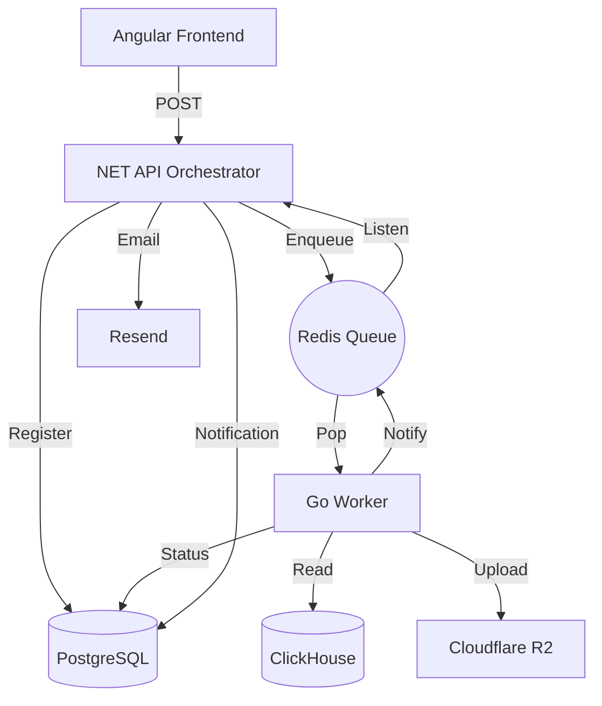
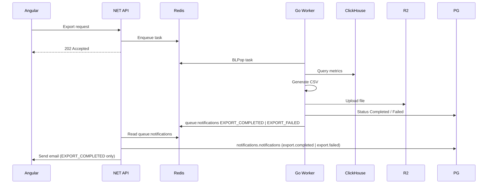
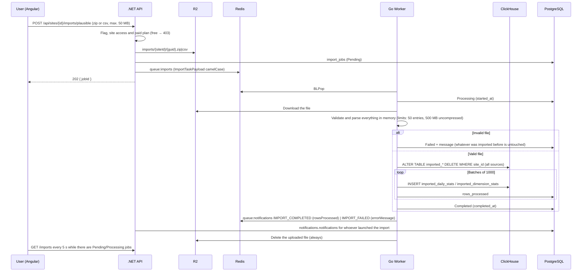

# TempooAnalytics: Data Jobs Flow (.NET & Go)

This document details the architecture of the asynchronous **Import** and **Export** processes, highlighting how .NET and Go collaborate through Redis.

## 🏗️ Communication Architecture



## 📤 Export Flow



1.  **Request**: The user requests a CSV from the Dashboard (.NET API).
2.  **Validation**: .NET checks that the user is on a paid plan and that there is no other active export for that site.
3.  **Registration and enqueueing**: .NET creates a record in `jobs.export_jobs` (status `Pending`) and sends a message to Redis.
4.  **Execution (Go)**: Queries ClickHouse, generates the CSV and uploads it to R2.
5.  **Completion**: Go updates the status in PostgreSQL and inserts the download URL.
6.  **Notification**: Go publishes `EXPORT_COMPLETED` or `EXPORT_FAILED` to `queue:notifications`. .NET sends the email (only if the export is ready) and stores the dashboard notification (see `docs/notifications.md`). If .NET cannot enqueue the export, it marks it Failed and notifies directly.

---

## 📥 Import Flow (Plausible)

> Behind the `FeatureFlags:PlausibleImport` feature flag (off by default). With the flag off the upload responds 404 and the dashboard does not mix in imported data. The GA4 import has its own flag (see below).



### Accepted format
- **Zip from Plausible's "Export data"**: one CSV per table, `{table}_{YYYYMMDD}_{YYYYMMDD}.csv`. They are recognised by prefix:
  `imported_visitors` (daily totals: visitors, pageviews, visits, bounces, visit_duration) and the breakdowns
  `imported_sources` → `referrer`, `imported_pages` → `path`, `imported_locations` → `country` (aggregated by country),
  `imported_devices` → `device`, `imported_browsers` → `browser`, `imported_operating_systems` → `os`.
  The remaining tables (entry/exit pages, custom events) are ignored. Without `imported_visitors` the job fails.
- **Loose CSV** with `date, visitors, pageviews` (old format): treated as `imported_visitors`.
- Headers are case-insensitive and tolerate spaces or a BOM. "Direct / None" is not stored as a source, and the most common sources ("Google", "Bing"…) are normalised to the domain Tempoo records.

### Re-import: one imported history per site
Each successful import, **from any source**, replaces everything previously imported for the site (delete all sources and insert): importing GA4 after Plausible leaves only GA4, and vice versa, so no day adds up two sources. There can only be one active import per site. If the worker fails between the delete and the insert, the site is left without imported history until it is retried.

---

## 📥 Import Flow (Google Analytics 4)

> Behind the `FeatureFlags:Ga4Import` feature flag (off by default). When off, the three endpoints respond 404 and the page shows "coming soon". It needs `Google:ClientId`, `Google:ClientSecret` and `Google:RedirectUri` (see `docs/google-oauth-setup.md`); without them the endpoints respond 503 and the API warns about it on startup.

```mermaid
sequenceDiagram
    participant User as User (Angular)
    participant API as .NET API
    participant Cache as Redis (encrypted cache)
    participant Google as Google (OAuth, Admin and Data API)
    participant BG as API (background service)
    participant R2 as R2
    participant Q as Redis queue:imports
    participant Go as Go Worker
    participant PG as PostgreSQL

    User->>API: POST /api/sites/{id}/imports/ga4/authorize
    API->>API: Flag, access, paid plan, active import (409), configuration (503)
    API->>Cache: ga4:state:{state} = {userId, siteId, code_verifier} (10 min)
    API-->>User: { authorizationUrl } (analytics.readonly, access_type=online, PKCE S256)
    User->>Google: Consent screen
    Google-->>User: /account/imports/google/callback?code&state (or error=access_denied)
    User->>API: POST .../ga4/connect { code, state }
    API->>Cache: Read and delete ga4:state (single use; user and site must match)
    API->>Google: Exchange the code (code_verifier) → access token (1 h, no refresh token)
    API->>Google: accountSummaries.list → GA4 properties
    API->>Cache: ga4:conn:{connectionId} = {token, listed properties} (≤ 10 min)
    API-->>User: { connectionId, properties }
    User->>API: POST .../ga4 { connectionId, propertyId }
    API->>Cache: Read and delete ga4:conn (the property must be listed)
    API->>PG: import_jobs (type 0, Pending, external_property_id, no configuration_json)
    API->>BG: In-memory Channel (jobId, siteId, propertyId, token)
    API-->>User: 202 { jobId }
    BG->>Google: properties.get (creation date) and runReport by month (7 reports)
    BG->>BG: Normalise to the Plausible export format (zip)
    alt Google error (401/403, 429, 5xx) or nothing to import
        BG->>PG: Failed + message (nothing is uploaded; whatever was imported before is kept)
        BG->>PG: notifications.notifications (import.failed), bypassing the queue
    else Success
        BG->>R2: imports/{siteId}/{jobId}.ga4.zip
        BG->>PG: start_date / end_date
        BG->>Q: ImportTaskPayload type GA4 (no token)
        Go->>Q: BLPop
        Go->>Go: Same path as Plausible with source = 'ga4'
    end
    User->>API: GET /imports every 5 s while there are Pending/Processing jobs
```

### Where the Google token lives and for how long
- It never reaches the browser, PostgreSQL (`configuration_json` stays `null`), the queue or the logs.
- Between `connect` and the choice of property: encrypted with DataProtection (purpose `Ga4Import.OAuth`) in the distributed cache, for at most 10 minutes (or whatever the token has left) and deleted when read.
- During the download: only in the memory of the API process (`Ga4DownloadRequest`). When it finishes, successfully or not, it is discarded. There is no refresh token, so each retry requires authorizing again.
- If the API restarts in the middle of a download, the token is lost: on startup (and every 10 minutes) the Pending GA4 jobs with no file (empty `start_date`) older than 1 hour are moved to Failed with "reconnect with Google".

### Range and metrics
- End: the day before the site's first real event, or yesterday if it has no events. Start: the property's creation date (minimum 2015-08-14). If the end is before the start, or Google returns no totals, the job fails with "nothing to import".
- Daily totals (`date`): `totalUsers` → visitors, `screenPageViews` → pageviews, `sessions` → visits, `sessions − engagedSessions` → bounces, `round(averageSessionDuration × sessions)` → visit_duration.
- Breakdowns (`date` + dimension, `totalUsers` and `screenPageViews`): `pagePath` (the 10,000 most viewed rows of each month), `sessionSource`, `countryId`, `deviceCategory`, `browser`, `operatingSystem`. `(direct)`, `(not set)` and `(other)` are discarded.
- Requests are sequential, one per report and month, paginated 100,000 rows at a time. A 429 (daily quota) ends the job.

### Cut-off date in the dashboard
Imported data is only used for days **before the site's first real event** (`min(date)` of `events`). The cut-off is computed once per request and only for sites with history; if the range does not touch imported days, the imported data is not queried. With no real events, the whole imported range is used.
- It is added in: the daily chart (day, week and month; not the hourly view), visitors, page views, sessions/visits, bounce rate, average duration and the lists of pages, sources, countries, devices, browsers and operating systems.
- Visitors from imported days are summed per day (they cannot be deduplicated).
- With filters applied, imported data is not included and the dashboard says so.
- `ImportedDataMerger` (API) holds the merge rules; public links use the same queries.

## 🏗️ Service Collaboration

TempooAnalytics uses an **Asynchronous Orchestration** pattern:

1.  **.NET API (The Orchestrator)**: Handles business logic, authentication, paid-plan validation and concurrency control.
2.  **Redis (The Message Bus)**: Acts as the bridge between services through lists (`queue:imports` from .NET to Go and `queue:notifications` from Go to .NET).
    *   ⚠️ **Technical note**: Using Redis is considered a **temporary solution** for job orchestration. Because of the need for greater durability, complex acknowledgements (ACKs) and scalability, there are plans to migrate this bus to **RabbitMQ** or a dedicated queue service in the future.
3.  **Go Worker (The Executor)**: Performs the heavy I/O work, stream processing and communication with data services (ClickHouse, S3/R2).

1.  **Input**: The user uploads the Plausible export, or connects Google Analytics and the API downloads and normalises the GA4 reports.
2.  **Enqueueing**: .NET stores the file in R2 and sends the task to Redis (never with third-party credentials).
3.  **Processing (Go)**: Parses the file and inserts into ClickHouse in blocks.
4.  **Feedback**: The user sees the real progress in Angular through PostgreSQL and, when it finishes, a notification in the header bell (flag `FeatureFlags:Notifications`).

### `queue:notifications` messages

Flat JSON object in camelCase, all values are strings. Go publishes after saving the job state; if the `LPUSH` fails, it is logged and the job is unchanged.

| Field | Types | Notes |
|---|---|---|
| `type` | all | `IMPORT_COMPLETED`, `IMPORT_FAILED`, `EXPORT_COMPLETED`, `EXPORT_FAILED` |
| `jobId` | all | job uuid |
| `siteId` | all | site uuid |
| `email`, `downloadUrl` | `EXPORT_COMPLETED` | Only for the email |
| `rowsProcessed` | `IMPORT_COMPLETED` | Number as a string |
| `errorMessage` | `IMPORT_FAILED`, `EXPORT_FAILED` | In `IMPORT_FAILED`, the same text as `error_message`; in `EXPORT_FAILED`, always `export failed` (the real error stays in the log and in `error_message`) |

The API ignores types it does not know.
